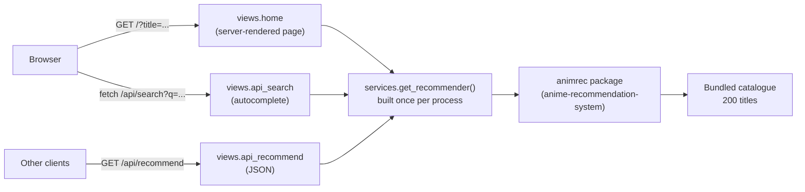

<div align="center">

# AnimRec: Anime Recommender Web App (Django)

**A Django web app where you pick an anime you like, or describe what you are in the mood for, and get similar shows with a short explanation of why each one was picked. The recommendations come from the shared model in [anime-recommendation-system](https://github.com/Collinsthe4th/anime-recommendation-system).**

[](https://github.com/Collinsthe4th/animrec-django/actions/workflows/ci.yml)
[](https://www.python.org/)
[](https://www.djangoproject.com/)

**Live demo:** the same model runs as a Streamlit app from the [model repository](https://github.com/Collinsthe4th/anime-recommendation-system#interactive-dashboard). This Django version is built to be self-hosted (see [Deployment](#deployment)).

</div>

---

## Contents

- [About the project](#about-the-project)
- [Architecture](#architecture)
- [Features](#features)
- [Tech stack](#tech-stack)
- [Getting started](#getting-started)
- [JSON API](#json-api)
- [Deployment](#deployment)
- [Testing](#testing)
- [Project structure](#project-structure)

## About the project

I first built the recommendation model as a notebook-style analysis. To put it in front of real users without copying the code, I turned the model into a Python package (`animrec`) in its own repository, and built this web app on top of it. Both repositories therefore use exactly the same model. A fix or a better weight in the model repository reaches the web app on its next install.

The model blends two signals: how similar the synopses are (TF-IDF with cosine similarity) and how many genres the shows share (Jaccard similarity), weighted 80% and 20%. The [model repository](https://github.com/Collinsthe4th/anime-recommendation-system#evaluation) explains how I chose that weight. With it, a title from the same franchise appears in the top 10 for 96.9% of the titles that have one.

## Architecture



The app stores nothing, so it has no models or migrations. The recommender is built the first time it is needed and then kept in memory (with `functools.lru_cache`), so each request only does a quick similarity lookup.

## Features

| | |
|---|---|
| **Search by title** | Typos and partial names are fine ("evangelion" finds "Shin Seiki Evangelion") |
| **Search by description** | Free text such as "high school basketball team" is matched against every synopsis |
| **Genre filter** | Limit results to one of 19 genres |
| **Explanations** | Each card shows the shared genres, the story match and the genre match |
| **Autocomplete** | Title suggestions while typing, from `/api/search` |
| **JSON API** | The same recommendations for other apps |
| **Production-ready settings** | Secrets from environment variables, WhiteNoise static files, secure cookies and HTTPS redirect when `DEBUG` is off |

## Tech stack

| Area | Tools |
|---|---|
| Web framework | Django 5 (function views, templates) |
| Model | `animrec` package (scikit-learn TF-IDF, NumPy) |
| Front end | HTML template, plain CSS, a few lines of JavaScript (no build step) |
| Serving | gunicorn, WhiteNoise |
| Testing | Django test runner (11 tests), `manage.py check --deploy`, GitHub Actions |

## Getting started

```bash
git clone https://github.com/Collinsthe4th/animrec-django.git
cd animrec-django
python -m venv .venv && source .venv/bin/activate   # Windows: .venv\Scripts\activate
pip install -r requirements.txt                     # also installs the animrec model from GitHub

python manage.py runserver
```

Then open http://127.0.0.1:8000 and try "Cowboy Bebop".

## JSON API

| Endpoint | Example | Returns |
|---|---|---|
| `GET /api/recommend` | `?title=trigun&k=5&genre=Action` | the matched title and a list of recommendations |
| `GET /api/recommend` | `?describe=space bounty hunters` | recommendations for a free-text description |
| `GET /api/search` | `?q=gund` | up to 8 matching titles |
| `GET /health` | | `{"status": "ok", "titles": 200}` |

Each recommendation includes `title`, `similarity`, `synopsis_similarity`, `genre_similarity`, `shared_genres`, `genres`, `score`, `episodes` and `synopsis`. Unknown titles return 404, and a missing query or an unknown genre returns 400.

## Deployment

The repository includes a `render.yaml` for [Render](https://render.com) and a `Procfile` for Heroku-style hosts. On Render, choose "New > Blueprint", point it at this repository, and it will build the app, collect the static files and start gunicorn. The required settings are listed in `.env.example`:

| Variable | Purpose |
|---|---|
| `DJANGO_SECRET_KEY` | secret key (Render generates one) |
| `DJANGO_DEBUG` | `0` in production |
| `DJANGO_ALLOWED_HOSTS` | the host name of the site |
| `DJANGO_CSRF_TRUSTED_ORIGINS` | the full `https://` origin of the site |

The settings refuse to start in production mode with the development secret key, so a missing variable fails loudly instead of running insecurely.

## Testing

```bash
python manage.py test
```

The 11 tests cover the page (form, title search, genre filter, description search, unknown titles and escaping of user input), the JSON API (results, 400 and 404 errors, autocomplete, health check, rejecting POST) and the input helpers. GitHub Actions also runs `check --deploy` and `collectstatic` with production settings on every push.

## Project structure

```
animrec-django/
├── animrec_site/            # settings, URLs, WSGI
├── recommender/
│   ├── services.py          # loads the shared animrec model once
│   ├── views.py             # page, JSON API, health check
│   ├── templates/recommender/home.html
│   ├── static/recommender/  # style.css, app.js
│   └── tests.py
├── render.yaml · Procfile · .env.example
└── requirements.txt
```

In conclusion, splitting the model and the web app into two repositories means the model can be evaluated and improved on its own, while the web app stays a thin, well-tested layer that only handles requests and presentation.
